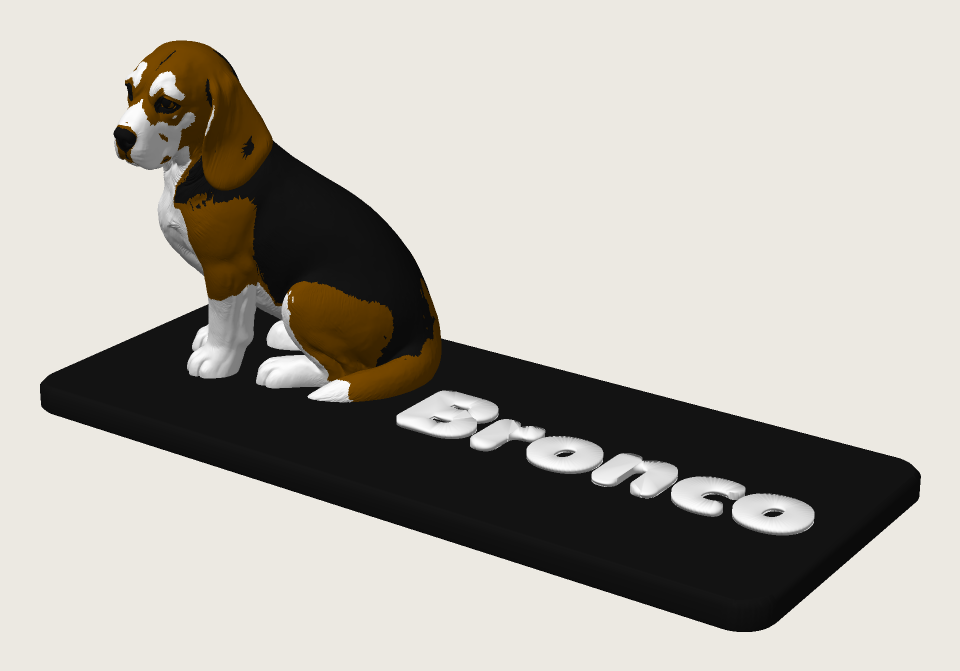
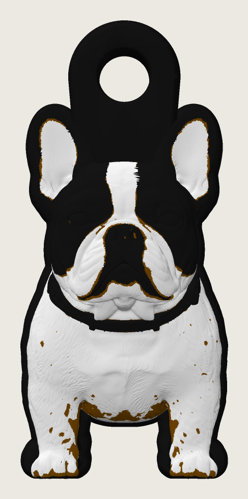
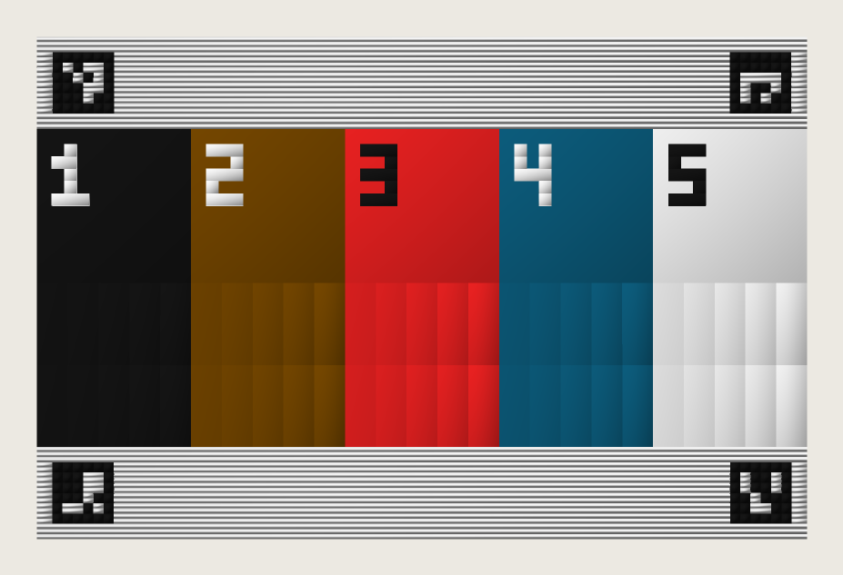
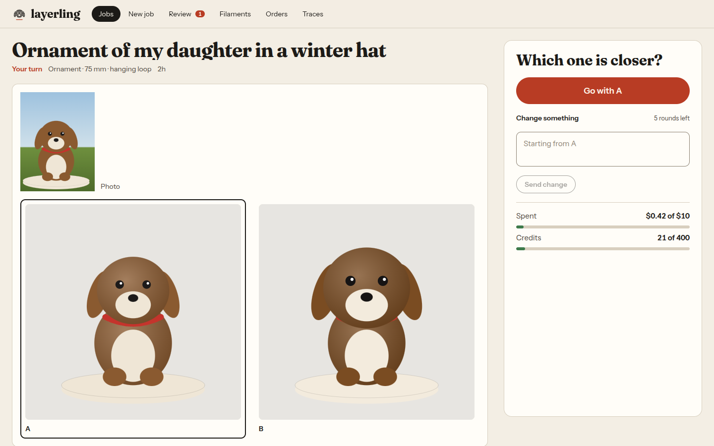

# layerling

Send it a few photos and a sentence like "keychain of my frenchie wearing a sombrero", and it hands back a multicolor 3MF that is ready to slice on a Bambu printer.

| Bronco nameplate | Frenchie keychain | Filament swatch card |
|---|---|---|
|  |  |  |
| [`examples/bronco-nameplate.3mf`](examples/bronco-nameplate.3mf) | [`examples/frenchie-keychain.3mf`](examples/frenchie-keychain.3mf) | [`examples/swatch-card.3mf`](examples/swatch-card.3mf) |

Those three files are real outputs, rendered straight from the 3MF in filament colors (`scripts/render_3mf_preview.py`). The Bronco nameplate prints in about 9 hours with 127 g of PLA; the Frenchie keychain takes 39 minutes and 9.5 g. Both are early versions: the brown speckles on the Frenchie are paint noise that the later palette and despeckle stages clean up. The swatch card is what I print to measure the real color of each spool.

## Why I built it

I print a lot on a Bambu, and the part I kept getting stuck on with pet keychains and little figures was color. Image-to-3D models come out with a texture, but a printer with five spools doesn't print textures. Somebody has to decide which triangle gets which filament, and do it in a way that survives the slicer. I wanted to see how much of that an AI pipeline could do on its own, for prints under 4 inches.

## How it works

```
photos + request
  -> s01 intake        Haiku 4.5 asks 2 to 4 questions (size, flat charm or 3D, a name for the plate)
  -> s02 color spec    Sonnet 5 writes down every color that matters; SAM 3 crops each part from the photos
  -> s03 concept       Meshy image-to-image renders two candidates; I pick one or ask for a change
  -> s04 views         side, back and 3/4 views of the approved concept
  -> s05 3D model      Meshy multi-image-to-3D builds a textured model; I approve it or retexture
  -> s06 geometry      scale, repair, orient, add the key ring, base or nameplate text (manifold3d)
  -> s07 baseline      Meshy multi-color as a starting point, mapped onto the real geometry
  -> s08 palette       pick the filaments in code: each one has to earn its purge grams and print time
  -> s09 paint         Opus 5.5 edits paint by region and judges a simulated print from 8 sides
  -> s10 write + gate  write the Bambu 3MF, slice it with Bambu Studio's CLI; nothing ships unless it slices
```

There are three places where a person decides something: the questions, the concept and the 3D model. Everything after that runs by itself. Then I open the file in Bambu Studio and print it.

A few details that took the most work:

- **The print simulator** (`sim/`). Slicers merge painted regions thinner than about two nozzle widths into their neighbor, and a light color over a few dark layers shows through. The paint agent judges this simulated print instead of the ideal paint, so it fixes what will actually come off the printer. It also models purge on the X2D's two nozzles.
- **The palette step** decides colors before any paint is done. On a rerun it took the Frenchie from 4 filaments, 5 h 7 min and 49 g of purge to 3 filaments, 2 h 26 min and 18 g.
- **A native slicer** (`slicer/`) that predicts time, grams and purge in seconds, calibrated against 20 Bambu Studio 2.08 slices in `slicer/calibration/`. The studio's paint editor uses it for instant previews; Bambu Studio is still the final gate.
- **Budgets.** Every Meshy and Claude call goes through a guard with a $10 and 400-credit cap per job. The first live job cost 66 Meshy credits and took 8 minutes end to end.

### Layout

| Path | What |
|---|---|
| `apps/web/` | Next.js 16 studio and public site (Tailwind 4, three.js viewer, paint editor) |
| `worker/` | FastAPI worker, stage runners, Meshy/Claude/Supabase clients, the orchestrator |
| `contracts/` | Shared Pydantic models and JSON Schemas; the web app's types are generated from these |
| `geometry/` | Stage 6: scale, repair, orient, loops, bases, raised name text |
| `threemf/` | Bambu 3MF writer, an independent reader, the slicer gate |
| `sim/` | Renderer, face-ID buffer, `simulate_print` |
| `slicer/` | Native slicer and G-code inspector, with calibration data |
| `mcp_paint/` | Paint tools as an MCP server, so Claude Code can repaint a job by hand |
| `sam3/` | SAM 3 part labels, back-projected from renders onto triangles |
| `filaments/` | Filament library, the 281-color Bambu catalog, swatch card calibration |
| `evals/` | 20-job golden set and a replay harness that reruns stored jobs for 0 credits |
| `costs/` | Cost and pricing model that feeds the site's prices |
| `supabase/` | Postgres schema, RLS, storage buckets, the Meshy webhook function |

Each Python package has its own README with more detail.

## Running it

You need Python 3.12 with [uv](https://docs.astral.sh/uv/), Node 20+, and Bambu Studio if you want the real slicer gate.

```bash
uv sync                  # all Python packages (one uv workspace)
uv run pytest            # Python tests
cd apps/web && npm install && npm test
```

The quickest way to see the whole thing is offline. The worker has a fake Meshy server built from recorded responses and a mock Claude, so this runs a job end to end for free and auto-answers the gates:

```bash
uv run python -m p2p_worker run-local --photo dog.jpg \
    --prompt "keychain of my dog" --product keychain --auto
uv run python -m p2p_worker status --job <id>
```

Job files land in `jobs/<job_id>/`, one folder per stage attempt. Add `--claude` to use real Claude through your Claude Code login, and `--profile full` for all ten stages.

The studio runs on mock data with no backend:

```bash
cd apps/web && npm run dev:mock     # http://localhost:3100
```



For real runs, copy `.env.example` to `.env` (or run `scripts/secrets.sh`, which prompts without echoing) and `apps/web/.env.example` to `apps/web/.env.local`.

| Variable | What |
|---|---|
| `MESHY_API_KEY`, `MESHY_MODE` | Meshy key; `test` (fake server), `replay` (stored outputs) or `live` |
| `MESHY_WEBHOOK_TOKEN` | Secret in the webhook URL; the edge function checks its SHA-256 (`MESHY_WEBHOOK_TOKEN_SHA256` function secret) |
| `CLAUDE_BACKEND` | `claude_code` (your Claude Code login, the default) or `api` |
| `ANTHROPIC_API_KEY_TURNKEY` | Only read when `CLAUDE_BACKEND=api` |
| `SUPABASE_URL`, `SUPABASE_SERVICE_ROLE_KEY` | Job rows, files and Realtime between the web app and the worker |
| `SAM3_BACKEND`, `SAM3_LOCAL_PATH` | `mock` by default; `local` runs SAM 3 on Apple MPS, CUDA or CPU from a weights folder you download yourself (`facebook/sam3` on Hugging Face, transformers format) |
| `RUNPOD_API_KEY`, `RUNPOD_SAM3_ENDPOINT_ID` | `SAM3_BACKEND=runpod`, a serverless endpoint built from `sam3/runpod/` |
| `SLICER_BIN` | Bambu Studio binary for the gate |
| `JOB_CAP_USD`, `JOB_CAP_CREDITS` | Per-job caps; hitting one pauses the job for review |

With Supabase set up (`supabase/migrations/`), run `uv run python -m p2p_worker serve --port 8787` and the web app's `npm run dev`. `worker/README.md` has every worker command.

### The golden set

`evals/golden/sets.json` lists 20 jobs (pets with people, two pets, black-and-white animals, objects) with their prompts and what intake should ask. The photos aren't in the repo. 32 come from Wikimedia Commons, and each entry has its URL, author and license, so you can download them into `evals/golden/photos/<set_id>/`. One set (`obj_eames_birds`) needs a product photo of your own. Any 1 to 3 JPEGs of the same subject work.

## What's rough

- It's built around my setup: a Bambu X2D with five AMS slots, Bambu Studio 2.08 profiles, and my spools in `filaments/library.json`. Other printers would need new profiles.
- The paint agent defaults to a stub (`PAINT_AGENT=stub`) that keeps the palette step's paint. The Opus agent works but is slow and the most expensive step.
- Some tweak routes (regenerate the mesh, geometry edits from chat) are recorded as decisions but don't act yet.
- 12 tests in `evals/` and the worker's chaos, credit-guard and resilience suites fail on main right now. Everything else passes (894 Python, 217 web).
- The public site was going to take orders, but payments, accounts and auto-starting prints were never in scope.
